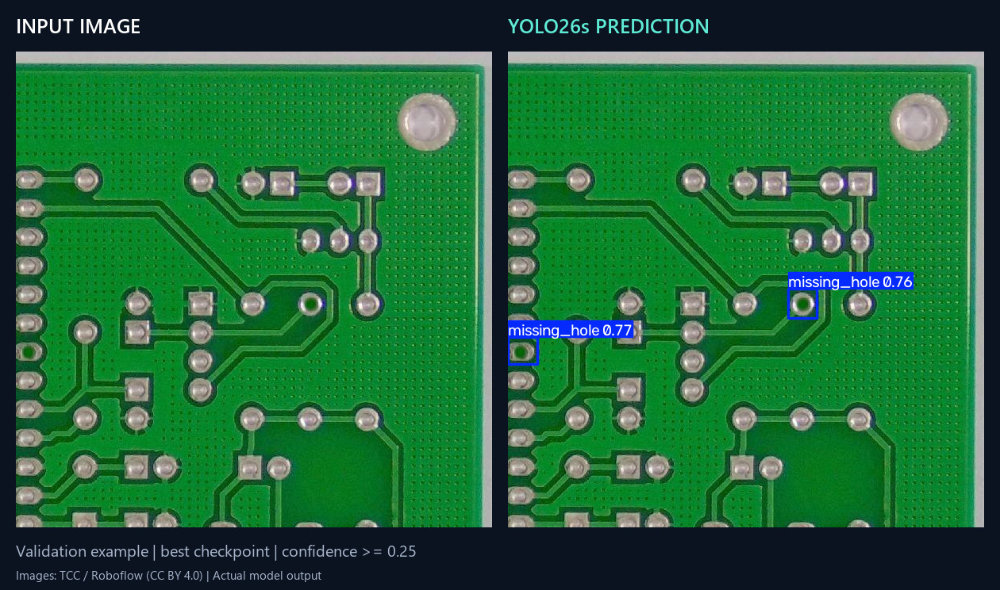
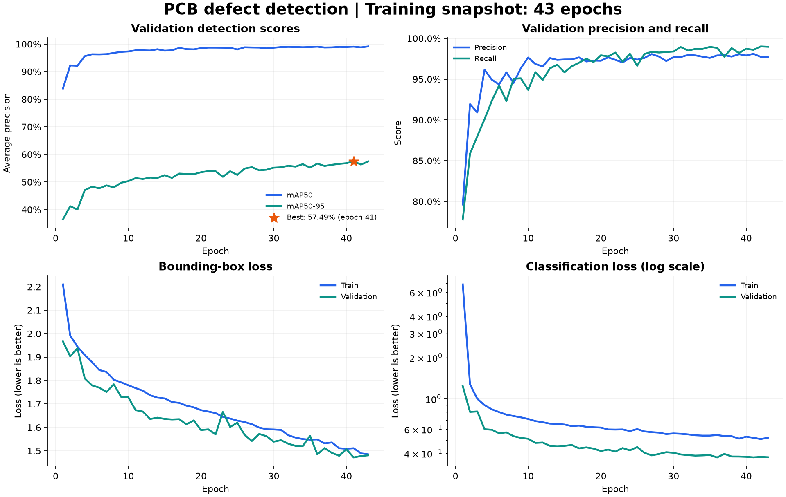
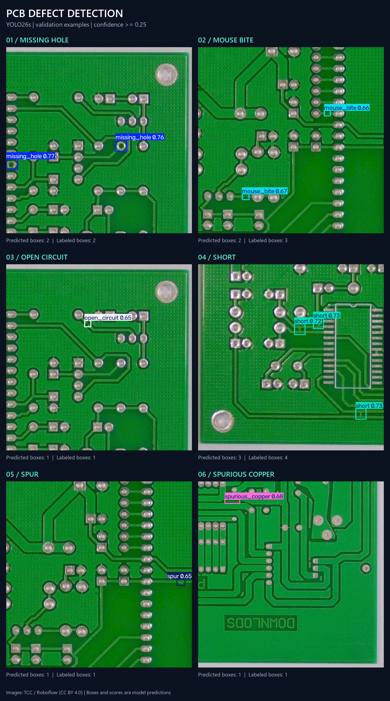

# PCB Defect Detection with YOLO26s

Detect and localize **six types of printed circuit board (PCB) defects** with YOLO26s. This project includes dataset auditing, training, checkpoint resumption, and inference scripts, with performance settings measured on an **NVIDIA GeForce RTX 5070 12 GB running Windows**.



> **Training snapshot:** Training is paused after epoch **43/100** and can resume from epoch 44. The best checkpoint is from **epoch 41**. Results below are **validation metrics**; the test split has not been evaluated, and the planned 100-epoch run is not complete.

[Results](#results) · [Demo](#demo) · [Dataset](#dataset) · [Installation](#installation) · [Training](#training) · [Prediction](#prediction) · [Performance](#performance)

## Results

Validation results on **798 images containing 1,588 annotated defects**. Source data: [training_results.csv](docs/results/training_results.csv) and [summary.json](docs/results/summary.json).

| Metric | Best checkpoint — epoch 41 | Latest checkpoint — epoch 43 |
|---|---:|---:|
| Precision | **98.11%** | 97.68% |
| Recall | 98.60% | **98.97%** |
| mAP50 | 99.06% | **99.14%** |
| mAP50–95 | **57.49%** | 57.43% |

`best.pt` is selected by the highest validation mAP50–95, while `last.pt` stores the latest state for resuming training. mAP measures object detection performance, rather than the percentage of correctly classified images. mAP50–95 evaluates bounding-box localization more strictly than mAP50.



From epoch 1 to the best checkpoint, mAP50–95 improved from **36.43% to 57.49%**. Scores generally improved as losses decreased, with fluctuations between epochs. Performance still needs verification on images of new boards; see [Limitations](#limitations).

## Demo

The images below show **actual predictions from the epoch-41 `best.pt` checkpoint** on validation images, using `imgsz=640`, `conf=0.25`, and FP16 GPU inference. Overlays show predicted bounding boxes, class names, and confidence scores.



Examples were selected by taking the first distinct image in filename order with labels for each class, without filtering by prediction confidence. The `mouse_bite` and `short` examples have fewer predicted boxes than annotated boxes, showing limitations at this threshold. Box counts alone do not establish whether every defect was correctly localized.

Source filenames, annotation counts, predicted boxes, and confidence scores are recorded in the [demo manifest](docs/results/summary.json). No test images were used for this demo.

## Dataset

This project uses [PCB dataset v2 — TCC / Roboflow](https://universe.roboflow.com/tcc-r4j2r/pcb-la0tj/dataset/2), containing **7,971 images** resized to 600 × 600, with YOLO detection labels.

| Split | Images | Bounding boxes |
|---|---:|---:|
| Train | 6,346 | 12,964 |
| Validation | 798 | 1,588 |
| Test | 827 | 1,660 |
| **Total** | **7,971** | **16,212** |

| ID | Class | Description |
|---|---|---|
| 0 | `missing_hole` | Missing drilled hole |
| 1 | `mouse_bite` | Notch along a copper trace edge |
| 2 | `open_circuit` | Broken copper trace |
| 3 | `short` | Unintended connection between traces |
| 4 | `spur` | Unwanted copper protrusion |
| 5 | `spurious_copper` | Unwanted copper fragment |

Download the dataset in YOLO detection format from the source above and arrange it as follows. Preserve the class ID order defined in `Dataset/data.yaml`:

```text
Dataset/
├── data.yaml
├── README.dataset.txt
├── README.roboflow.txt
├── train/
│   ├── images/
│   └── labels/
├── valid/
│   ├── images/
│   └── labels/
└── test/
    ├── images/
    └── labels/
```

Dataset images and labels are excluded from the Git repository by `.gitignore`. Download them separately before auditing or training. The training script automatically creates a dataset configuration with absolute paths at `.runtime/pcb.yaml`.

## Installation

Tested environment: **Windows, Python 3.12, PyTorch 2.9.1+cu128, torchvision 0.24.1+cu128, and Ultralytics 8.4.208**, with an NVIDIA driver supporting CUDA 12.8.

Install [uv](https://docs.astral.sh/uv/getting-started/installation/) if it is not already available. In PowerShell:

```powershell
winget install --id astral-sh.uv -e
```

Open a new terminal, then run these commands from the project directory:

```powershell
$env:UV_CACHE_DIR = "$PWD\.runtime\uv-cache"
$env:UV_PYTHON_INSTALL_DIR = "$PWD\.runtime\python"

uv python install 3.12
uv venv --python 3.12 .venv

uv pip install --python .venv/Scripts/python.exe --link-mode copy torch==2.9.1 torchvision==0.24.1 --index-url https://download.pytorch.org/whl/cu128
uv pip install --python .venv/Scripts/python.exe --link-mode copy -r requirements.txt
uv pip check --python .venv/Scripts/python.exe
```

If you are using the original machine with a project-local uv installation, replace `uv` with `.\.runtime\uv\uv.exe`. A package-version snapshot from the tested environment is available in [requirements-lock.txt](requirements-lock.txt).

Verify that PyTorch detects the GPU:

```powershell
.\.venv\Scripts\python.exe -c "import torch; print(torch.__version__); print(torch.cuda.is_available()); print(torch.cuda.get_device_name(0))"
```

## Training

### 1. Audit the dataset

```powershell
.\.venv\Scripts\python.exe check_dataset.py
```

The audit checks image/label pairs, class IDs, bounding boxes, and duplicate images across splits, then saves `dataset_audit.json`. This dataset had **0 label errors and 0 exact cross-split image duplicates**, but some filenames suggest shared source images; see [Limitations](#limitations).

### 2. Start training

Use the preset measured on the RTX 5070 12 GB:

```powershell
.\.venv\Scripts\python.exe train.py --profile rtx5070
```

| Setting | Value |
|---|---|
| Pretrained model | `yolo26s.pt` |
| Image size | 640 × 640 |
| Maximum epochs | 100 |
| Early stopping | `patience=25` |
| Batch / workers | 32 / 2 |
| Precision / memory format | AMP FP16 / NCHW |
| Image cache | Disk |
| Performance mode | cuDNN autotuning, deterministic execution disabled |

Pretrained weights are downloaded automatically if they are not already present. Early stopping ends training after 25 consecutive epochs without an improvement in validation fitness. This preset was measured on the machine described above. Reduce the batch size when using a GPU with less available VRAM or when other applications consume more GPU memory.

For a custom configuration, such as a GPU with less VRAM:

```powershell
.\.venv\Scripts\python.exe train.py --batch 8 --workers 2 --cache disk --fast
```

Run a short smoke test before training on the full dataset:

```powershell
.\.venv\Scripts\python.exe train.py --epochs 1 --fraction 0.02 --name smoke --skip-test
```

The smoke test verifies that the pipeline runs; its results should not be used to assess model quality.

### 3. Resume from a checkpoint

The run documented here is paused after **epoch 43**. Resume from epoch 44 with:

```powershell
.\.venv\Scripts\python.exe train.py --resume runs/detect/pcb_yolo26s/weights/last.pt --profile rtx5070
```

Resuming restores the model weights, optimizer state, and training state from the checkpoint. After stopping a run, use the `last.pt` checkpoint from the most recently saved epoch to continue.

### 4. Output files

```text
runs/detect/pcb_yolo26s/
├── args.yaml
├── results.csv
├── weights/
│   ├── best.pt       # Highest validation fitness
│   └── last.pt       # Latest checkpoint for resuming
└── test_metrics.json # Created after training and test evaluation
```

After training finishes or early stopping triggers, the script automatically evaluates `best.pt` on the test split unless `--skip-test` is used. **The current snapshot has no test metrics** because training was paused before completion.

If a run name already exists, Ultralytics creates a new output directory. Check the path printed in the log and use the corresponding path for `--weights` or `--resume`. The CSV `time` counter restarts when training resumes, so do not subtract timestamps across sessions to calculate throughput.

## Prediction

A trained checkpoint is required for prediction. Model weight files (`*.pt`) are not included in this repository.

Run prediction on the demo input included in the repository:

```powershell
.\.venv\Scripts\python.exe predict.py --source docs/assets/demo_input.jpg
```

Process an image directory:

```powershell
.\.venv\Scripts\python.exe predict.py --source Dataset/valid/images --conf 0.25
```

Use a custom checkpoint and replace the source path with your own image or video:

```powershell
.\.venv\Scripts\python.exe predict.py --source "path/to/pcb.jpg" --weights "path/to/best.pt" --conf 0.25
```

Annotated images and label files containing confidence scores are saved under `runs/detect/predict*`. Add `--device cpu` for CPU inference.

### Regenerate the README assets

```powershell
.\.venv\Scripts\python.exe scripts/build_readme_assets.py
```

This requires the dataset and `runs/detect/pcb_yolo26s/weights/best.pt`. The script generates validation demo images, training curves, and result snapshots under `docs/` without starting a new training run. After further training, update the README text and tables to match the new snapshot.

## Performance

Benchmarks were run on **an RTX 5070 12 GB**, approximately 32 GB of RAM, a CPU with 10 cores / 16 logical processors, and Windows. The PyTorch build includes `sm_120`, matching the GPU's compute capability of 12.0.

Throughput was measured over **20 training batches after 5 warmup batches**, using real dataset images and excluding setup and validation. Each configuration was measured once; these are not averages across repeated runs.

| Batch | Workers | Memory format | TF32 | Images/sec | Peak CUDA reserved |
|---|---:|---|---|---:|---:|
| 8 | 2 | NCHW | Off | 61.5 | 2.42 GiB |
| 16 | 2 | NCHW | Off | 123.8 | 4.74 GiB |
| **32** | **2** | **NCHW** | **Off** | **161.5** | **9.22 GiB** |
| 32 | 4 | NCHW | Off | 158.1 | 9.20 GiB |
| 32 | 2 | NCHW | On | 161.0 | 9.20 GiB |
| 32 | 2 | Channels-last | On | 31.3 | 9.19 GiB |

The selected configuration is **batch 32 + workers 2 + NCHW**. TF32 changed measured throughput by less than 1%, so the original FP32 matrix multiplication precision was retained. Channels-last was slower on this Windows machine.

Measured epoch time after initial setup decreased from **93.7 to 45.6 seconds**, a **2.05× speedup / 51% reduction in elapsed time**, comparing baseline epoch 2 with optimized epoch 4. See [performance_report.json](performance_report.json) for details.

The table reports CUDA memory reserved by PyTorch, rather than total system GPU memory usage. Total VRAM usage during training, including Windows and other applications, was approximately 11.3 GB out of 12 GB. Disk caching creates `.npy` files alongside the source images, using approximately 8 GB of additional disk space; these files are ignored by Git. Fast mode may produce slightly different results between runs because deterministic execution is disabled.

## Project structure

```text
.
├── README.md
├── train.py                       # Train, resume, RTX 5070 preset, final test evaluation
├── predict.py                     # Predict images / folders / videos
├── check_dataset.py               # Audit labels and split overlap
├── benchmark_training.py          # Internal short training-throughput benchmark
├── requirements.txt
├── requirements-lock.txt
├── dataset_audit.json
├── performance_report.json
├── Dataset/                       # Metadata tracked; images/labels downloaded separately
├── scripts/
│   └── build_readme_assets.py
└── docs/
    ├── assets/                    # Real demo images and training curves
    └── results/                   # CSV snapshot and metrics/demo manifest
```

`.venv/`, `.runtime/`, `runs/`, model weights, and raw dataset files are excluded by `.gitignore`. The images and result snapshots in `docs/` are included so GitHub can display them without depending on ignored files.

## Limitations

- Current results are validation metrics from 43 training epochs. Test performance and generalization to images of new boards have not been verified.
- Hash checks found no byte-identical images across splits. However, removing the `l_` / `rotation_*_` prefixes and Roboflow hashes from filenames revealed **693 potentially shared source names between train and validation**, and **712 between train and test**. This is a filename heuristic; visual similarity has not been confirmed.
- Validation scores may overestimate performance on new boards. Split data by original board or source image before creating rotated, relit, or cropped variants, and use the test split after model selection.
- High mAP50 does not guarantee precise boxes or detection of every defect. Review mAP50–95, failure examples, and per-class results as well.

## Attribution & references

- **Dataset / demo source images:** [PCB v2 — TCC / Roboflow](https://universe.roboflow.com/tcc-r4j2r/pcb-la0tj/dataset/2), [CC BY 4.0](https://creativecommons.org/licenses/by/4.0/). Demo figures add prediction overlays, text, and layouts to the source images. Original export credits are preserved in `Dataset/README.dataset.txt` and `Dataset/README.roboflow.txt`.
- **Model and training:** [Ultralytics YOLO26](https://docs.ultralytics.com/models/yolo26/) · [Training documentation](https://docs.ultralytics.com/modes/train/) · [Ultralytics licensing](https://www.ultralytics.com/license)
- **Environment:** [PyTorch installation](https://pytorch.org/get-started/previous-versions/) · [uv installation](https://docs.astral.sh/uv/getting-started/installation/)
